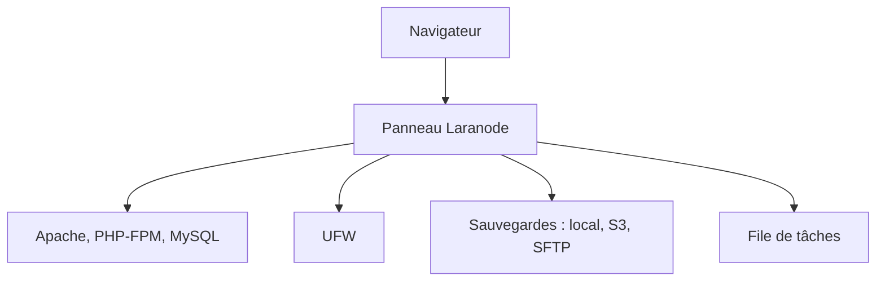

# crivion/laranode

> Open-source hosting control panel, an alternative to cPanel and Plesk, for VPS and dedicated servers.

## The problem
Managing the sites, databases, certificates and firewall of a VPS by hand is time-consuming; cPanel and Plesk are licensed.

## What it actually does
Laranode manages multiple accounts, sites, Let's Encrypt SSL, a file manager, PHP versions, MySQL databases, the UFW firewall and live system statistics. The backup manager backs up and restores accounts, files and databases locally, to S3 or SFTP, with scheduling.

## How it is wired
Simplified diagram based on the sheet, no diagram provided.



## Trying it
```bash
curl -sSL https://raw.githubusercontent.com/crivion/laranode/refs/heads/main/laranode-scripts/bin/laranode-installer.sh | bash
git clone https://github.com/crivion/laranode.git && cd laranode
docker compose up -d --build
docker compose exec laranode laranode-artisan laranode:create-admin
```

## Cost and gotchas
Requires Ubuntu 24.04+, 1 vCPU, 2 GB of RAM and 10 GB of disk, on a fresh server. The installer runs by pulling a remote script. Demo mode must never run on a real server.

## What it is not
Not a tool for hosting models or pipelines: it is a LAMP stack. Do not install it on a server already in use.

## Alternatives
- cPanel: the README cites it as the licensed product that the repository replaces.
- Plesk: same remark.

## For you
Ignore: a PHP web hosting panel unrelated to data, AI or MLOps.
