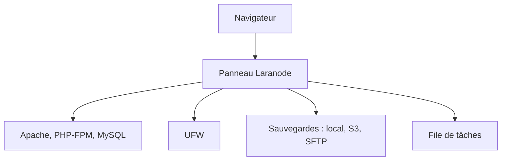

# crivion/laranode

> Panneau de contrôle d'hébergement libre, alternative à cPanel et Plesk, pour VPS et serveurs dédiés.

## Le problème
Gérer sites, bases, certificats et pare-feu d'un VPS à la main est long ; cPanel et Plesk sont sous licence.

## Ce que ça fait vraiment
Laranode gère plusieurs comptes, sites, SSL Let's Encrypt, un gestionnaire de fichiers, les versions de PHP, les bases MySQL, le pare-feu UFW et des statistiques système en direct. Le gestionnaire de sauvegardes sauvegarde et restaure comptes, fichiers et bases en local, S3 ou SFTP, avec planification.

## Comment c'est branché
Schéma simplifié d'après la fiche, sans diagramme fourni.



## Essayer
```bash
curl -sSL https://raw.githubusercontent.com/crivion/laranode/refs/heads/main/laranode-scripts/bin/laranode-installer.sh | bash
git clone https://github.com/crivion/laranode.git && cd laranode
docker compose up -d --build
docker compose exec laranode laranode-artisan laranode:create-admin
```

## Coût et pièges
Il faut Ubuntu 24.04+, 1 vCPU, 2 Go de RAM et 10 Go de disque, sur un serveur neuf. L'installateur s'exécute en tirant un script distant. Le mode démo ne doit jamais tourner sur un serveur réel.

## Ce que ce n'est pas
Pas un outil pour héberger des modèles ou des pipelines : c'est une pile LAMP. Ne s'installe pas sur un serveur déjà utilisé.

## Alternatives
- cPanel : le README le cite comme produit sous licence que le dépôt remplace.
- Plesk : même remarque.

## Pour toi
À ignorer : panneau d'hébergement web PHP sans lien avec la donnée, l'IA ou le MLOps.

