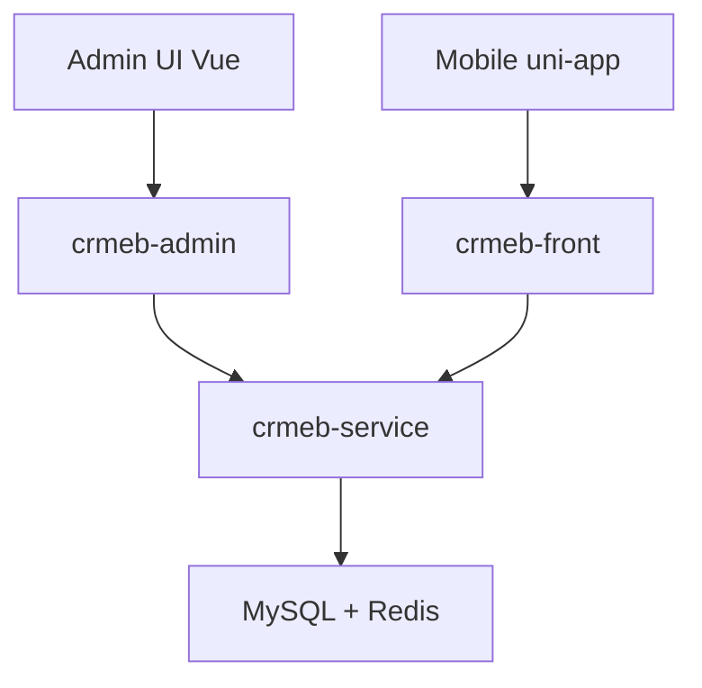

# crmeb/crmeb_java

> Open source online shop system (Java, Vue, uni-app), with marketing and multi-terminal support, of Chinese origin.

## The problem
Setting up a multi-channel shop (WeChat mini-programs, H5, app, PC) requires assembling many building blocks.

## What it actually does
Spring Boot backend (admin, front, service, common modules) with MyBatis-Plus, MySQL and Redis; a Vue + Element admin console; mobile in uni-app. Management of products, orders, payments, ECharts statistics, about ten marketing tools (promotions, points, distribution), fine-grained permissions, a theme marketplace. External services: OSS/Qiniu, SMS, WeChat.

## How it is wired

## Trying it
No commands in the README; it points to the online installation documentation.

## Cost and gotchas
Free (Apache-2.0). Java 1.8, Node 14, MySQL 8 and Redis are required; SpringBoot 2.2.6 is old. Some themes and plugins are paid.

## What it is not
Neither a data tool nor a global platform: it is strongly oriented toward the Chinese WeChat ecosystem.

## Alternatives
No alternative named in the README.

## For you
Ignore: off-topic e-commerce, with an aging Java 8 stack.
