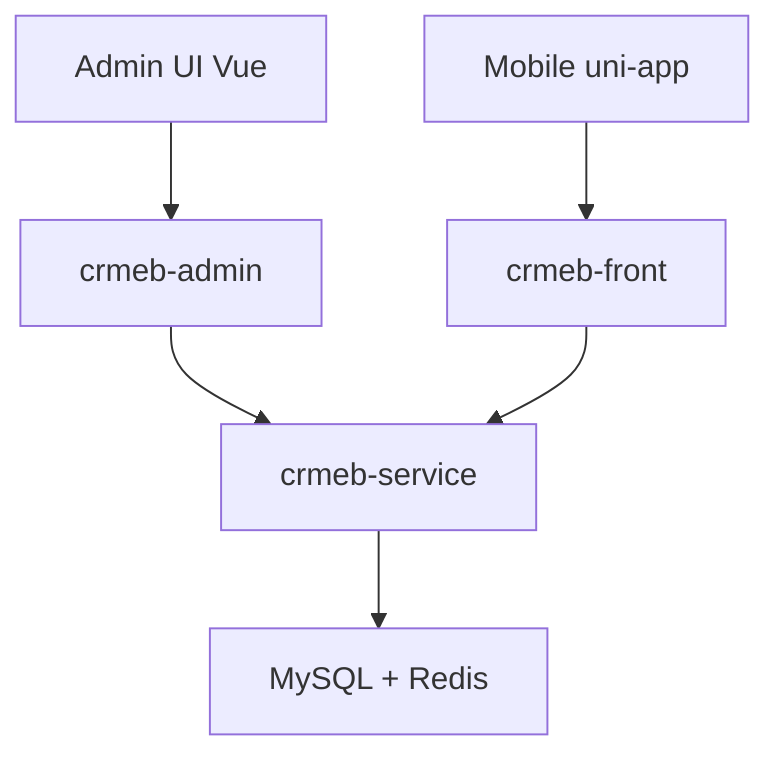

# crmeb/crmeb_java

> Système de boutique en ligne open source (Java, Vue, uni-app), avec marketing et multi-terminaux, d'origine chinoise.

## Le problème
Monter une boutique multi-canaux (mini-programmes WeChat, H5, app, PC) demande beaucoup de briques à assembler.

## Ce que ça fait vraiment
Backend Spring Boot (modules admin, front, service, common) avec MyBatis-Plus, MySQL et Redis ; console d'administration Vue + Element ; mobile en uni-app. Gestion des produits, commandes, paiements, statistiques ECharts, une dizaine d'outils marketing (promotions, points, distribution), permissions fines, marché de thèmes. Services externes : OSS/Qiniu, SMS, WeChat.

## Comment c'est branché

## Essayer
Aucune commande dans le README ; il renvoie à la documentation d'installation en ligne.

## Coût et pièges
Gratuit (Apache-2.0). Java 1.8, Node 14, MySQL 8, Redis requis ; SpringBoot 2.2.6 est ancien. Certains thèmes et plugins sont payants.

## Ce que ce n'est pas
Ni un outil data ni une plateforme mondiale : très orienté écosystème WeChat chinois.

## Alternatives
Aucune alternative nommée dans le README.

## Pour toi
À ignorer : e-commerce hors sujet, avec une pile Java 8 vieillissante.

