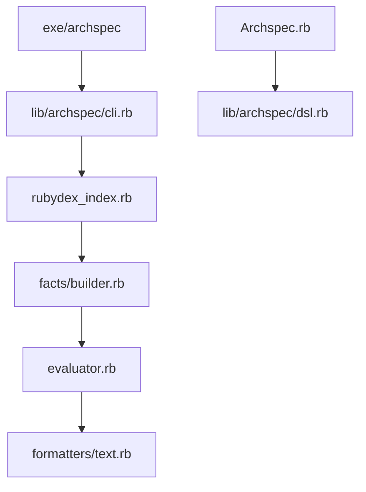

# crmne/archspec

> Executable architecture specifications for Ruby and Rails, checked by static analysis.

## The problem
Architecture rules live in review comments and in seniors' heads, and code written by agents ignores them.

## What it actually does
An Archspec.rb file declares components, layers and rules (dependencies, calls, naming, cycles). The check command indexes the code with Rubydex, builds facts, then applies the rules without starting the application or calling any AI. It offers ready-made architectures (Rails, hexagonal, CQRS), a debt file and local suppressions.

## How it is wired


## Trying it
```sh
bundle install
bundle exec archspec init
bundle exec archspec check
bundle exec archspec check --format json
bundle exec archspec explain app/models/user.rb
```

## Cost and gotchas
Free. Ruby 3.2 or later is required: this requirement does not appear in the list of prerequisites. Zeitwerk names are not checked.

## What it is not
Not a design-pattern detector: it checks the rules you describe, it infers nothing.

## Alternatives
No alternative named in the README.

## For you
Ignore: reserved for Ruby and Rails applications, outside your data, AI or MLOps scope.
