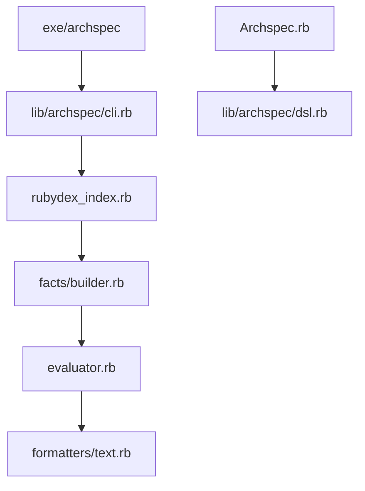

# crmne/archspec

> Spécifications d'architecture exécutables pour Ruby et Rails, vérifiées par analyse statique.

## Le problème
Les règles d'architecture vivent dans des commentaires de revue et la tête des seniors, et le code écrit par des agents les ignore.

## Ce que ça fait vraiment
Un fichier Archspec.rb déclare composants, couches et règles (dépendances, appels, nommage, cycles). La commande check indexe le code avec Rubydex, construit des faits puis applique les règles sans démarrer l'application ni appeler d'IA. Elle propose des architectures prêtes (Rails, hexagonale, CQRS), un fichier de dette et des suppressions locales.

## Comment c'est branché


## Essayer
```sh
bundle install
bundle exec archspec init
bundle exec archspec check
bundle exec archspec check --format json
bundle exec archspec explain app/models/user.rb
```

## Coût et pièges
Gratuit. Il faut Ruby 3.2 ou plus : ce besoin n'existe pas dans la liste des prérequis. Les noms Zeitwerk ne sont pas vérifiés.

## Ce que ce n'est pas
Pas un détecteur de motifs de conception : il vérifie les règles que tu décris, il n'infère rien.

## Alternatives
Aucune alternative nommée dans le README.

## Pour toi
À ignorer : réservé aux applications Ruby et Rails, hors de ton périmètre data, IA ou MLOps.

