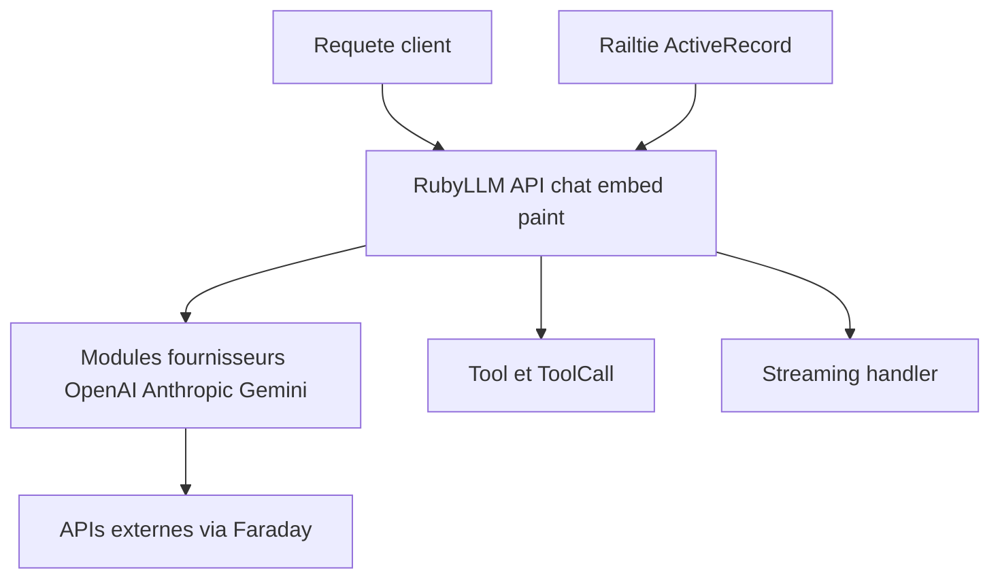

# crmne/ruby_llm

> Ruby framework with a single API for 23 model providers, agents, evaluations and Rails integration.

## The problem
Each LLM provider has its own SDK; a Ruby/Rails application rewrites its calling layer every time the model changes.

## What it actually does
`RubyLLM.chat`, `embed`, `paint`, `transcribe`, `rerank`, `moderate`, `ocr`, Ruby tools, agents (`RubyLLM::Agent`), structured output, streaming, cost tracking, fallback to a backup model, MCP. On the `main` branch: sandboxed code execution, skills, evaluations. Rails integration (`acts_as_chat`, Active Record, Hotwire).

## How it is wired


## Trying it
```bash
bundle add ruby_llm --version 2.1.1
```
```ruby
RubyLLM.configure { |config| config.openai_api_key = ENV.fetch('OPENAI_API_KEY') }
RubyLLM.chat.ask "What's the best way to learn Ruby?"
```

## Cost and gotchas
Provider keys are at your expense; several examples require distinct providers (Mistral for OCR, Cohere for reranking). Evaluations, code and skills: `main` branch only.

## What it is not
Not a Python framework. The provided diagram dates from an earlier version (4 providers instead of 23).

## Alternatives
No alternative named in the README.

## For you
Worth watching only if you integrate LLMs into a Rails app; outside Ruby, no direct interest.
