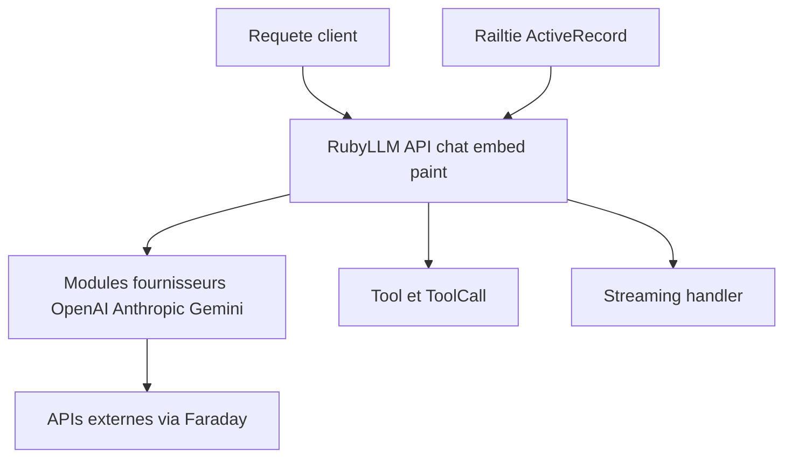

# crmne/ruby_llm

> Framework Ruby avec une API unique pour 23 fournisseurs de modèles, agents, évaluations et intégration Rails.

## Le problème
Chaque fournisseur de LLM a son SDK ; une application Ruby/Rails réécrit sa couche d'appel à chaque changement de modèle.

## Ce que ça fait vraiment
`RubyLLM.chat`, `embed`, `paint`, `transcribe`, `rerank`, `moderate`, `ocr`, outils Ruby, agents (`RubyLLM::Agent`), sortie structurée, flux, suivi des coûts, repli sur modèle de secours, MCP. Sur la branche `main` : exécution de code en bac à sable, compétences, évaluations. Intégration Rails (`acts_as_chat`, Active Record, Hotwire).

## Comment c'est branché


## Essayer
```bash
bundle add ruby_llm --version 2.1.1
```
```ruby
RubyLLM.configure { |config| config.openai_api_key = ENV.fetch('OPENAI_API_KEY') }
RubyLLM.chat.ask "What's the best way to learn Ruby?"
```

## Coût et pièges
Clés des fournisseurs à ta charge ; plusieurs exemples demandent des fournisseurs distincts (Mistral pour l'OCR, Cohere pour le reranking). Évaluations, code et compétences : branche `main` seulement.

## Ce que ce n'est pas
Pas un framework Python. Le diagramme fourni date d'une version antérieure (4 fournisseurs au lieu de 23).

## Alternatives
Aucune alternative nommée dans le README.

## Pour toi
À surveiller seulement si tu intègres du LLM dans une appli Rails ; hors Ruby, aucun intérêt direct.

