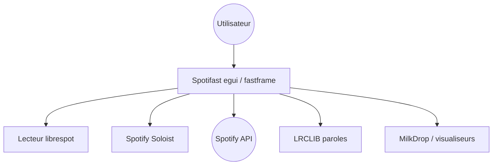

# crmne/spotifast

> Desktop Spotify client written in Rust with egui, without a browser engine.

## The problem
The official client is heavy; you want a native player with equalizer, visualizers and mini-player.

## What it actually does
Browsing, search and playlist editing, playback via Spotify Soloist or the built-in librespot player, lyrics (Spotify then LRCLIB), Spotify Connect, Google Cast, queue, themes, Winamp mini-player and MilkDrop visuals. Playback requires Spotify Premium and an application registered in the developer dashboard.

## How it is wired


## Trying it
```bash
brew install --cask crmne/tap/spotifast
yay -S spotifast-bin
sudo apt install ./spotifast_*.deb
```

## Cost and gotchas
Spotify Premium is mandatory, including to create the developer application (Client ID). No playback with a free account.

## What it is not
Not a data/AI tool. Depends entirely on Spotify and librespot ("What Spotify allows" page cited).

## Alternatives
No alternative named in the README.

## For you
Ignore: a consumer application unrelated to data/AI/MLOps work.
