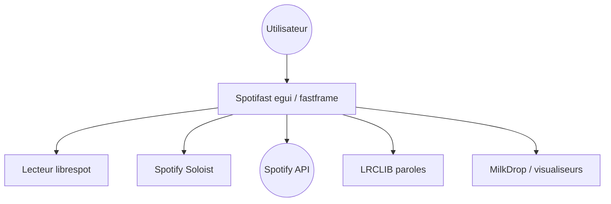

# crmne/spotifast

> Client Spotify de bureau écrit en Rust avec egui, sans moteur de navigateur.

## Le problème
Le client officiel est lourd ; on veut un lecteur natif avec égaliseur, visualiseurs et mini-lecteur.

## Ce que ça fait vraiment
Navigation, recherche et édition de playlists, lecture via Spotify Soloist ou le lecteur librespot intégré, paroles (Spotify puis LRCLIB), Spotify Connect, Google Cast, file d'attente, thèmes, mini-lecteur Winamp et visuels MilkDrop. La lecture exige Spotify Premium et une application enregistrée dans le tableau de bord développeur.

## Comment c'est branché


## Essayer
```bash
brew install --cask crmne/tap/spotifast
yay -S spotifast-bin
sudo apt install ./spotifast_*.deb
```

## Coût et pièges
Spotify Premium obligatoire, y compris pour créer l'application développeur (Client ID). Aucune lecture avec un compte gratuit.

## Ce que ce n'est pas
Pas un outil data/IA. Dépend entièrement de Spotify et de librespot (page « What Spotify allows » citée).

## Alternatives
Aucune alternative nommée dans le README.

## Pour toi
À ignorer : application grand public sans lien avec un travail data/IA/MLOps.

