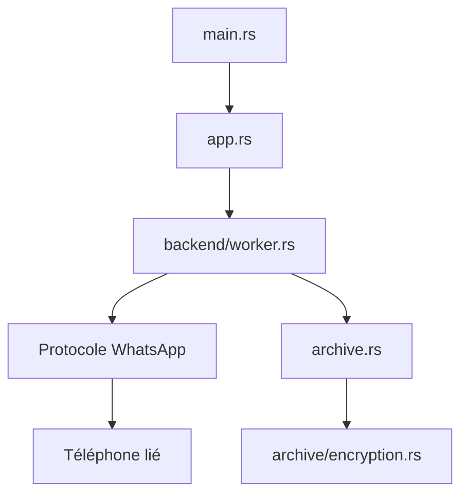

# crmne/zapfast

> Native desktop WhatsApp client in Rust and egui, linked to the phone as a companion device.

## The problem
WhatsApp Web uses a lot of memory (1.13 GB in their test) because it runs in a browser.

## What it actually does
Native application with no browser engine, which links to the phone by QR code through whatsapp-rust. Messages, media, polls, stickers, multiple numbers, encrypted local archive, notifications, themes. About 200 MB of RAM at idle according to their measurement.

## How it is wired


## Trying it
```bash
brew install --cask crmne/tap/zapfast
yay -S zapfast-bin
```

## Cost and gotchas
Free, but an existing WhatsApp account is required. It relies on an unofficial protocol: the README points to an "Account safety" page on the risk to the account. GIF search via GIPHY.

## What it is not
Not an official Meta client. Not independent of the service: everything depends on the WhatsApp network.

## Alternatives
- WhatsApp Web: official, but much more memory-hungry.

## For you
Ignore: desktop messaging unrelated to data, and it puts your WhatsApp account at risk.
