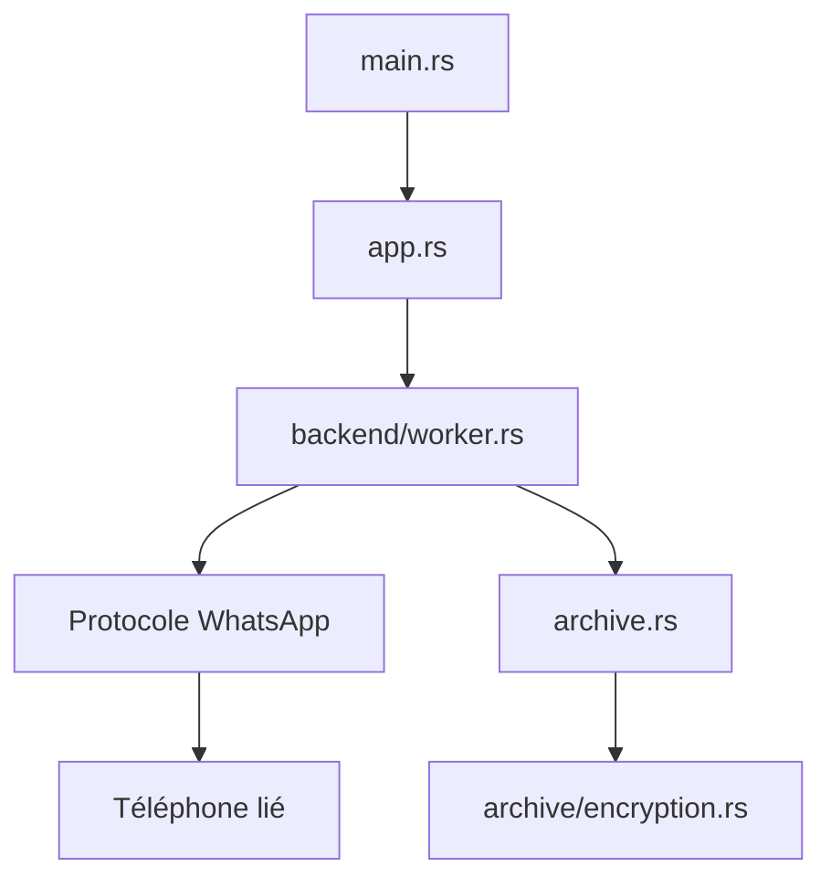

# crmne/zapfast

> Client WhatsApp de bureau natif en Rust et egui, lié au téléphone comme appareil compagnon.

## Le problème
WhatsApp Web consomme beaucoup de mémoire (1,13 Go dans leur test) parce qu'il tourne dans un navigateur.

## Ce que ça fait vraiment
Application native sans moteur de navigateur, qui se lie au téléphone par QR code via whatsapp-rust. Messages, médias, sondages, stickers, plusieurs numéros, archive locale chiffrée, notifications, thèmes. Environ 200 Mo de RAM au repos d'après leur mesure.

## Comment c'est branché


## Essayer
```bash
brew install --cask crmne/tap/zapfast
yay -S zapfast-bin
```

## Coût et pièges
Gratuit, mais il faut un compte WhatsApp existant. Il s'appuie sur un protocole non officiel : le README renvoie à une page « Account safety » sur le risque pour le compte. Recherche GIF via GIPHY.

## Ce que ce n'est pas
Pas un client officiel de Meta. Pas indépendant du service : tout dépend du réseau WhatsApp.

## Alternatives
- WhatsApp Web : officiel, mais bien plus gourmand en mémoire.

## Pour toi
Ignorer : messagerie de bureau sans rapport avec la data, et qui fait courir un risque au compte WhatsApp.

