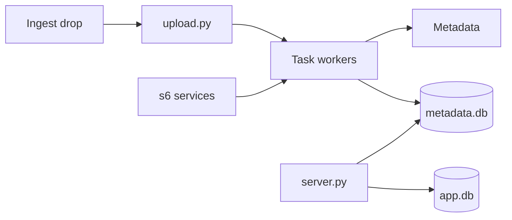

# crocodilestick/Calibre-Web-Automated

> Self-hosted digital library combining the Calibre-Web interface and Calibre's automations.

## The problem
Containerized Calibre is heavy and hard to use on mobile, Calibre-Web lacks features: you end up running both.

## What it actually does
Watched ingest folder: automatic import of 28 formats, conversion (EPUB, MOBI, AZW3, KEPUB, PDF), EPUB repair.
Metadata fetched at import and written back into the files; backup of originals, duplicates, dynamic shelves.
Automatic sending to e-reader, KOReader and Kobo sync, OAuth/OIDC, statistics.
Services supervised by s6 in a single container; special mode for network shares (NFS/SMB).

## How it is wired


## Trying it
```bash
curl -OL https://raw.githubusercontent.com/crocodilestick/calibre-web-automated/main/docker-compose.yml
docker compose up -d
```

## Cost and gotchas
Free; default admin credentials (admin/admin123) must be changed. Files in the ingest folder are deleted after processing.
GPL-3.0 license.

## What it is not
Not a data or AI tool.
Not multi-library: one library per instance.

## Alternatives
- Calibre-Web: base version, lighter.
- Calibre: full version, heavy in a container.

## For you
Ignore for your professional watch: excellent homelab project for books, unrelated to data or MLOps.
