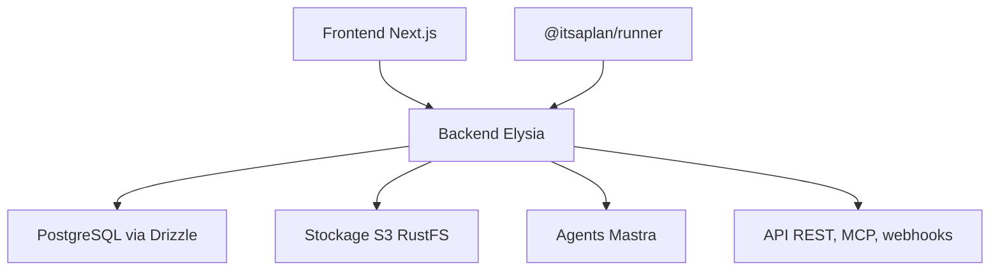

# croffasia/itsaplan

> A self-hosted ticket manager where AI agents work like teammates.

## The problem
Project management tools charge per user and treat AI agents as external integrations, not as team members.

## What it actually does
Full ticket tracking: projects, kanban boards, cycles, custom fields, dashboards, documents. Agents have a role and permissions, receive tickets and are launched by mention, assignment or schedule. They run internally on any model, or externally via a runner (@itsaplan/runner) that hands the task to Claude Code, Codex, opencode or others. REST API, MCP server and webhooks.

## How it is wired
Simplified diagram based on the sheet, no diagram provided.


## Trying it
```bash
git clone https://github.com/croffasia/itsaplan.git
cd itsaplan
bun install
bun run setup   # answer "Try it"
```

## Cost and gotchas
Docker and Bun required, PostgreSQL database and S3 storage to host. Agents call your own model keys. A paid Pro edition exists for features such as the audit log and per-workspace SSO.

## What it is not
Not stable: the README announces breaking changes before the first stable release. Enterprise features (audit, AI budgets) are reserved for the Pro edition.

## Alternatives
- Linear: the tool the project aims to replace, as a hosted service.
- Plane: cited as a replaced tool, also open source.

## For you
Worth watching: the idea of agents assigned like board members is interesting for AI workflows, but the project is young and unstable.
