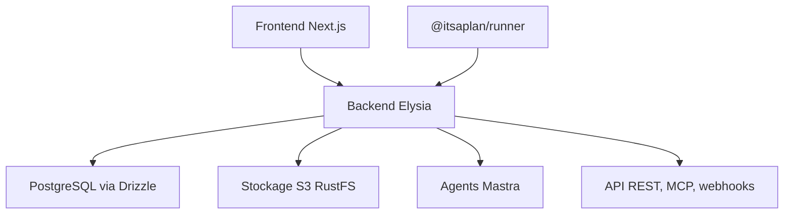

# croffasia/itsaplan

> Un gestionnaire de tickets auto-hébergé où des agents IA travaillent comme des coéquipiers.

## Le problème
Les outils de gestion de projet facturent par utilisateur et traitent les agents IA comme des intégrations externes, pas comme des membres de l'équipe.

## Ce que ça fait vraiment
Un suivi de tickets complet : projets, tableaux kanban, cycles, champs personnalisés, tableaux de bord, documents. Les agents ont un rôle et des droits, reçoivent des tickets et se lancent par mention, affectation ou planning. Ils tournent en interne sur n'importe quel modèle, ou en externe via un exécuteur (@itsaplan/runner) qui confie la tâche à Claude Code, Codex, opencode ou autre. API REST, serveur MCP et webhooks.

## Comment c'est branché
Schéma simplifié d'après la fiche, sans diagramme fourni.


## Essayer
```bash
git clone https://github.com/croffasia/itsaplan.git
cd itsaplan
bun install
bun run setup   # answer "Try it"
```

## Coût et pièges
Docker et Bun requis, base PostgreSQL et stockage S3 à héberger. Les agents appellent tes propres clés de modèles. Une édition Pro payante existe pour des fonctions comme le journal d'audit et le SSO par espace de travail.

## Ce que ce n'est pas
Pas stable : le README annonce des changements incompatibles avant la première version stable. Les fonctions d'entreprise (audit, budgets IA) sont réservées à l'édition Pro.

## Alternatives
- Linear : l'outil que le projet vise à remplacer, en service hébergé.
- Plane : cité comme outil remplacé, lui aussi open source.

## Pour toi
À surveiller : l'idée d'agents affectés comme des membres du tableau est intéressante pour des workflows IA, mais le projet est jeune et instable.

