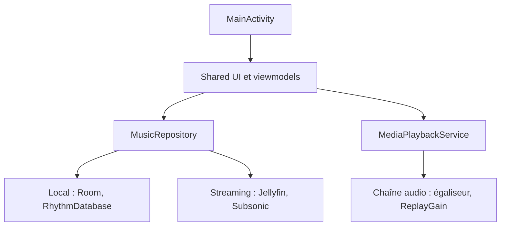

# cromaguy/Rhythm

> Open source Android music player, local or streaming from Subsonic, Navidrome and Jellyfin.

## The problem
Android music players are often loaded with tracking or limited in audio settings and personal streaming.

## What it actually does
Kotlin app with Jetpack Compose and Material 3. It plays the local library (Room database) or a remote server (Subsonic, Navidrome, Jellyfin). The Media3 ExoPlayer engine handles gapless playback, a 10-band equalizer, ReplayGain and crossfade. It offers synced lyrics, listening statistics and widgets.

## How it is wired

## Trying it
No command in the README: install via Google Play, F-Droid, IzzyOnDroid, Obtainium or the APK from the GitHub releases. Android 8.0 minimum, 2 GB of RAM.

## Cost and gotchas
Free. The GitHub, F-Droid and IzzyOnDroid builds include all features (covers, lyrics); the Play variant may differ.

## What it is not
Not a work tool: it is a consumer Android app, with no API and no pipeline use.

## Alternatives
No alternative named in the README.

## For you
Ignore: an excellent player for the phone, but unrelated to your data, AI or MLOps work.
