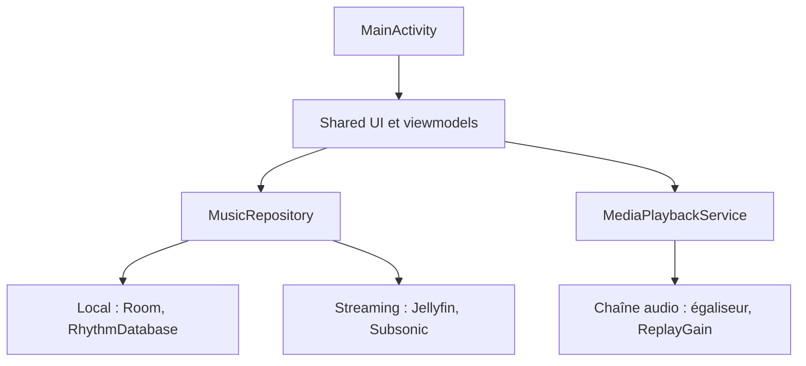

# cromaguy/Rhythm

> Lecteur de musique Android open source, local ou en streaming Subsonic, Navidrome et Jellyfin.

## Le problème
Les lecteurs musicaux Android sont souvent bardés de pistage ou limités côté réglage audio et streaming personnel.

## Ce que ça fait vraiment
Application Kotlin avec Jetpack Compose et Material 3. Elle lit la bibliothèque locale (base Room) ou un serveur distant (Subsonic, Navidrome, Jellyfin). Le moteur Media3 ExoPlayer gère lecture sans coupure, égaliseur 10 bandes, ReplayGain et fondu enchaîné. Elle propose paroles synchronisées, statistiques d'écoute et widgets.

## Comment c'est branché

## Essayer
Aucune commande dans le README : installation via Google Play, F-Droid, IzzyOnDroid, Obtainium ou l'APK des releases GitHub. Android 8.0 minimum, 2 Go de RAM.

## Coût et pièges
Gratuit. Les versions GitHub, F-Droid et IzzyOnDroid incluent toutes les fonctions (pochettes, paroles) ; la variante Play peut en différer.

## Ce que ce n'est pas
Pas un outil de travail : c'est une application grand public Android, sans API ni usage en pipeline.

## Alternatives
Aucune alternative nommée dans le README.

## Pour toi
À ignorer : excellent lecteur pour le téléphone, mais sans rapport avec ton métier data, IA ou MLOps.

