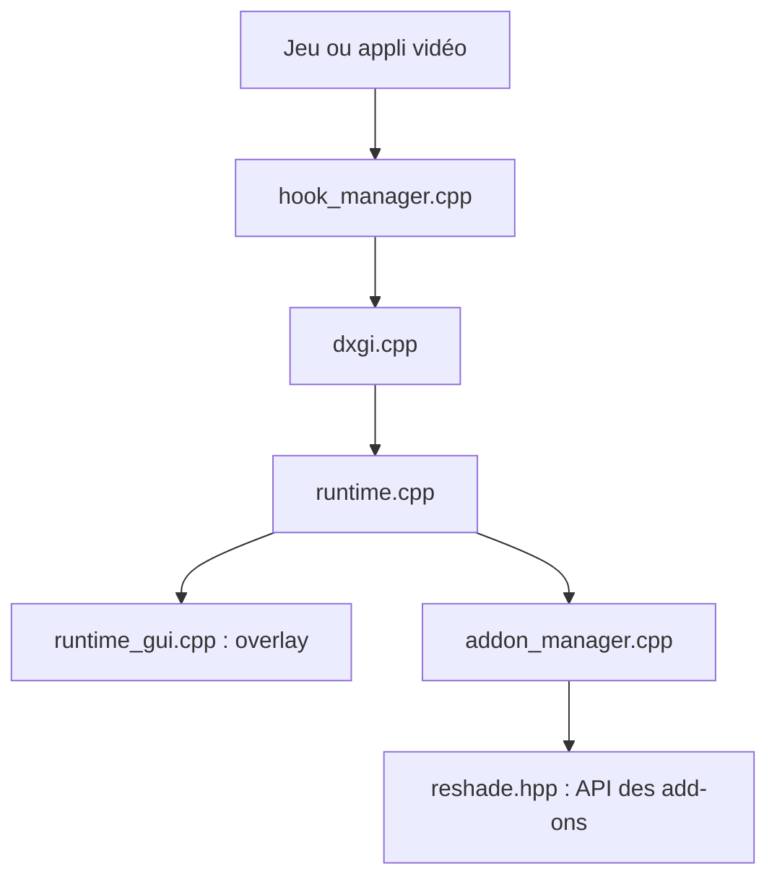

# crosire/reshade

> Post-processing injector for games and video software, with a shader language for writing effects.

## The problem
Applying ambient occlusion, depth of field or color correction to a graphics application that does not offer them.

## What it actually does
ReShade injects itself into the application through hooks on the graphics APIs (DXGI, D3D11, Vulkan, OpenGL), reads the color and depth of each frame, then runs effects written in ReShade FX. An overlay manages presets. Add-ons (DLLs) extend the tool through an API. The shader compiler is standalone and reusable in another project.

## How it is wired


## Trying it
```bash
git clone --recurse-submodules https://github.com/crosire/reshade
```
Then open the Visual Studio solution, choose the 32 or 64-bit target and build.

## Cost and gotchas
Free. Build with Visual Studio 2017 or later, plus Python in the PATH for the `glad` dependency. For installing it, the README only describes building.

## What it is not
It is not a data or AI tool. The README talks about injection into games; the repository is not an intrusion tool but a graphics effects engine.

## Alternatives
No alternative named in the README.

## For you
Ignore: graphics rendering for Windows games, unrelated to your data or MLOps pipelines.
