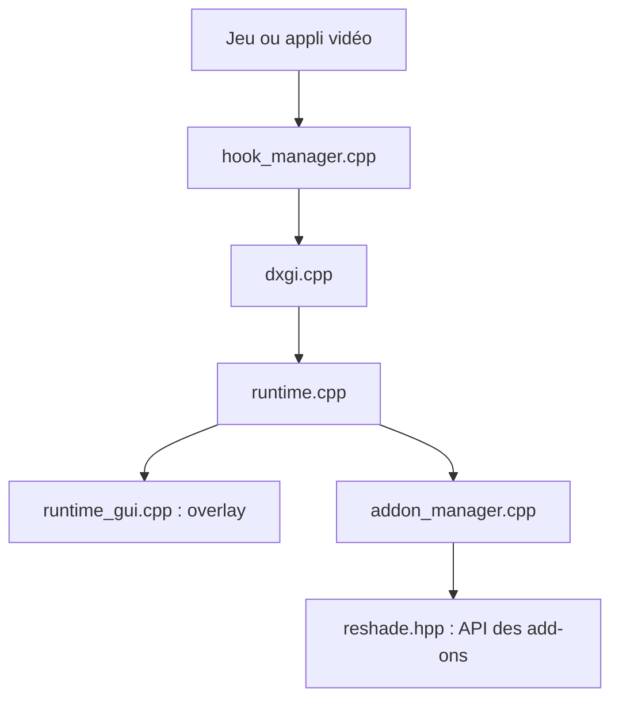

# crosire/reshade

> Injecteur de post-traitement pour jeux et logiciels vidéo, avec un langage de shaders pour écrire des effets.

## Le problème
Appliquer occlusion ambiante, profondeur de champ ou correction colorimétrique à une application graphique qui ne les propose pas.

## Ce que ça fait vraiment
ReShade s'injecte dans l'application via des hooks sur les API graphiques (DXGI, D3D11, Vulkan, OpenGL), lit la couleur et la profondeur de chaque image, puis exécute des effets écrits en ReShade FX. Un overlay gère les préréglages. Des add-ons (DLL) étendent l'outil via une API. Le compilateur de shaders est autonome et réutilisable dans un autre projet.

## Comment c'est branché


## Essayer
```bash
git clone --recurse-submodules https://github.com/crosire/reshade
```
Puis ouvrir la solution Visual Studio, choisir la cible 32 ou 64 bits et compiler.

## Coût et pièges
Gratuit. Compilation avec Visual Studio 2017 ou plus, plus Python dans le PATH pour la dépendance `glad`. Pour l'installer, le README ne décrit que la compilation.

## Ce que ce n'est pas
Ce n'est pas un outil de data ni d'IA. Le README parle d'injection dans des jeux ; le dépôt n'est pas un outil d'intrusion mais un moteur d'effets graphiques.

## Alternatives
Aucune alternative nommée dans le README.

## Pour toi
À ignorer : rendu graphique pour jeux sous Windows, sans lien avec tes pipelines data ou MLOps.

