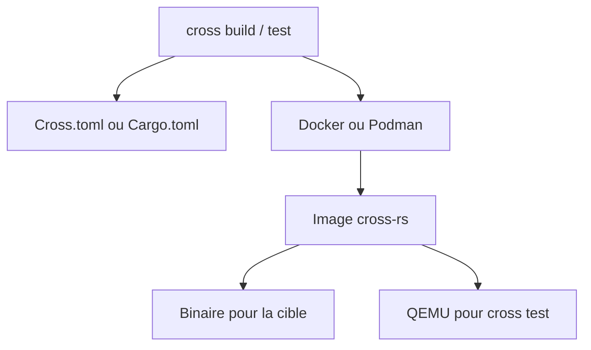

# cross-rs/cross

> Zero-setup cross-compilation and cross-testing of Rust crates, via Docker or Podman containers.

## The problem
Compiling Rust for another architecture forces you to install toolchains and libraries by hand, at the risk of messing up your system.

## What it actually does
`cross` has the same interface as Cargo, but runs the build inside a container image that holds the environment, the cross toolchain and the libraries. It also lets you test on architectures other than i686 and x86_64 using QEMU. Configuration is through `Cross.toml`, `Cargo.toml` or environment variables.

## How it is wired
Simplified diagram based on the fiche, no diagram provided.



## Trying it
```bash
cargo install cross --git https://github.com/cross-rs/cross
sudo systemctl start docker
cross build --target aarch64-unknown-linux-gnu
cross test --target mips64-unknown-linux-gnuabi64
```

## Cost and gotchas
Free. Requires rustup and Docker 20.10+ or Podman 3.4+. The Linux kernel must support `binfmt_misc` for cross tests. MSVC and Apple Darwin images are not provided pre-built.

## What it is not
It is not a Python or data tool: it is only for Rust. Xargo is no longer supported. Inside a container, you have to mount the Docker socket.

## Alternatives
No alternative named in the README.

## For you
Ignore: only useful if you ship Rust for other architectures, which is rare for a data / AI / MLOps profile.
