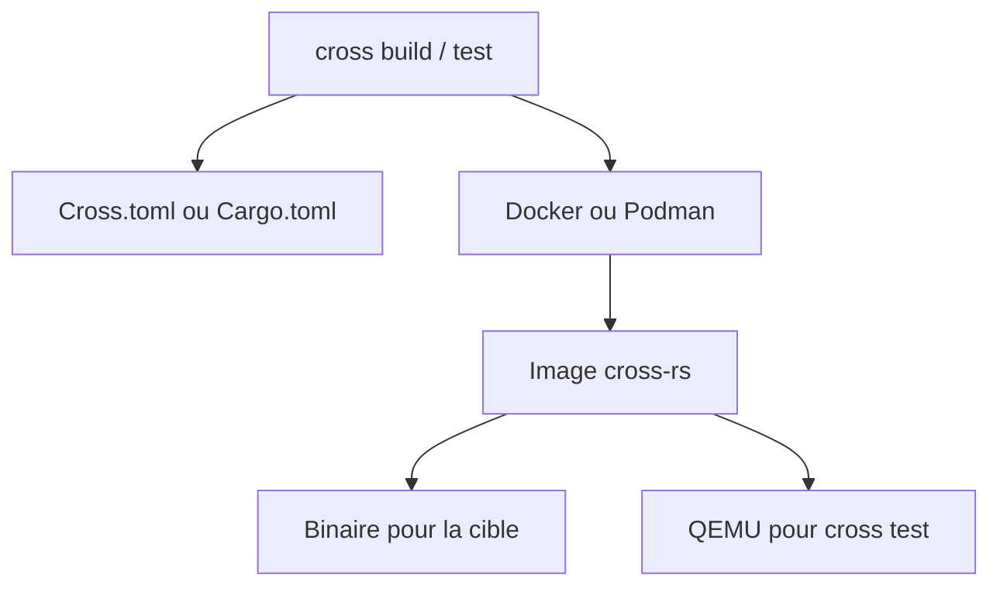

# cross-rs/cross

> Compilation croisée et tests croisés de crates Rust sans réglage, via conteneurs Docker ou Podman.

## Le problème
Compiler du Rust pour une autre architecture oblige à installer chaînes d'outils et bibliothèques à la main, au risque de salir son système.

## Ce que ça fait vraiment
`cross` a la même interface que Cargo, mais lance la compilation dans une image de conteneur qui contient l'environnement, la chaîne croisée et les bibliothèques. Il permet aussi de tester sur des architectures autres que i686 et x86_64 avec QEMU. Configuration par `Cross.toml`, `Cargo.toml` ou variables d'environnement.

## Comment c'est branché
Schéma simplifié d'après la fiche, sans diagramme fourni.



## Essayer
```bash
cargo install cross --git https://github.com/cross-rs/cross
sudo systemctl start docker
cross build --target aarch64-unknown-linux-gnu
cross test --target mips64-unknown-linux-gnuabi64
```

## Coût et pièges
Gratuit. Il faut rustup et Docker 20.10+ ou Podman 3.4+. Le noyau Linux doit gérer `binfmt_misc` pour les tests croisés. Les images MSVC et Apple Darwin ne sont pas fournies pré-construites.

## Ce que ce n'est pas
Ce n'est pas un outil Python ni data : il ne sert qu'à du Rust. Xargo n'est plus pris en charge. Dans un conteneur, il faut monter le socket Docker.

## Alternatives
Aucune alternative nommée dans le README.

## Pour toi
À ignorer : utile seulement si tu livres du Rust pour d'autres architectures, ce qui est rare pour un profil data / IA / MLOps.

