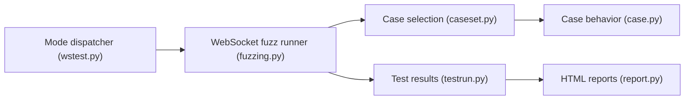

# crossbario/autobahn-testsuite

> WebSocket conformance suite that tests clients and servers, for protocol implementers.

## The problem
Checking that a WebSocket implementation complies with the specification and withstands edge cases.

## What it actually does
- More than 500 cases: frames, ping/pong, fragmentation, UTF-8, closing, permessage-deflate compression.
- "fuzzingserver" mode to test clients, "fuzzingclient" to test servers; HTML reports.
- Auxiliary tools: echo and broadcast servers, WAMP, mass-connect, wsperf.
- The Docker image is deliberately frozen on PyPy 2.7; the Python package only works on Python 2.

## How it is wired


## Trying it
```bash
docker run -it --rm -v "${PWD}/config:/config" -v "${PWD}/reports:/reports" -p 9001:9001 --name fuzzingserver crossbario/autobahn-testsuite:25.10.1
```

## Cost and gotchas
Free. Old environment (Python 2) deliberately frozen.

## What it is not
Not a general-purpose load testing tool.

## Alternatives
The README cites autobahn-python for test clients in Python 3.

## For you
Ignore: only useful if you write a WebSocket library, outside everyday data/AI work.
