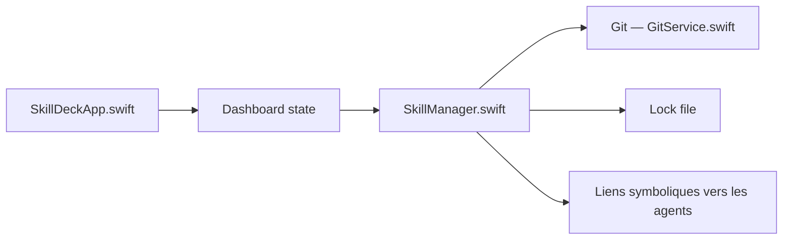

# crossoverJie/SkillDeck

> macOS application to manage the skills of several coding agents from a single interface.

## The problem
Agent skills (Claude Code, Codex, Gemini CLI…) live in separate folders: manual edits, symbolic links and hand-written YAML.

## What it actually does
SkillDeck lists skills (folders containing `SKILL.md`), installs them from GitHub or a local folder, then assigns them to agents through symbolic links. It browses registries (skills.sh, ClawHub), detects updates, offers a `SKILL.md` editor and watches the file system. The file system serves as the database.

## How it is wired


## Trying it
```bash
brew tap crossoverJie/skilldeck && brew install --cask skilldeck
xattr -cr /Applications/SkillDeck.app
swift run SkillDeck
swift test
```

## Cost and gotchas
Free, macOS 14+ only. The application is not signed: macOS blocks it on first launch. Online translation requires macOS 26+.

## What it is not
Not an agent editor or a skill runner: it manages files and links. No Linux or Windows version.

## Alternatives
No alternative named in the README.

## For you
Worth watching: useful if you juggle several agents on a Mac, but a one-person project and limited gain if you only use one agent.
