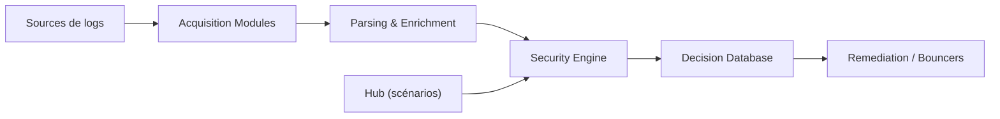

# crowdsecurity/crowdsec

> Open source security engine that detects malicious behavior in logs and blocks IPs.

## The problem
Spotting attacks (brute force, port scans, web scans) in server logs and blocking their sources, without maintaining rules yourself.

## What it actually does
The engine reads logs from varied sources (files, syslog, docker, journald, Kafka, CloudWatch…), parses and enriches them, applies detection scenarios, then produces decisions stored in a database. Remediation components (bouncers) enforce the blocking at other levels (firewall, HTTP). Scenarios and rules are fetched from the Hub; the principle is "detect here, remediate elsewhere". It also acts as a WAF.

## How it is wired

## Trying it
No command is documented in the README, which points to the documentation for installing on Linux, Windows, Docker, OpnSense or Kubernetes.

## Cost and gotchas
The engine is free. Community blocklists rely on sharing signals with the network (the README says users share the threats they encounter). The console, extra lists and premium features belong to a separate service.

## What it is not
It is not an antivirus or a data analysis tool: it only protects what goes through analyzed logs and deployed bouncers.

## Alternatives
The README names no alternative.

## For you
Keep an eye on it: useful for protecting an exposed server hosting an API or a model, but it is security operations work, with data sharing to accept knowingly.
