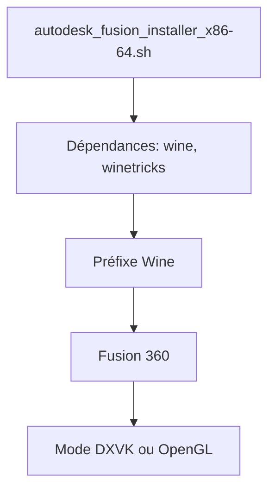

# cryinkfly/Autodesk-Fusion-360-for-Linux

> Installation script that runs Autodesk Fusion 360 on Linux using Wine.

## The problem
Fusion 360 officially exists only for Windows and macOS; Linux users have to maintain a fragile Wine prefix by hand.

## What it actually does
A shell script installs the dependencies (Wine, winetricks, p7zip, cabextract…), prepares a Wine prefix and installs Fusion 360, with a `--full` option for the tested extensions. It offers a DXVK or OpenGL mode. The application itself remains Autodesk's.

## How it is wired
Simplified diagram based on the sheet, no diagram provided.


## Trying it
```bash
curl -L https://raw.githubusercontent.com/cryinkfly/Autodesk-Fusion-360-for-Linux/main/files/setup/autodesk_fusion_installer_x86-64.sh -o "autodesk_fusion_installer_x86-64.sh" && chmod +x autodesk_fusion_installer_x86-64.sh && ./autodesk_fusion_installer_x86-64.sh --install --default
```

## Cost and gotchas
The script is free but a valid Autodesk license is mandatory (30-day trial, limited personal use, paid subscription). The repository is archived: the project is moving to Codeberg. The listed distributions are not supported by Autodesk.

## What it is not
It is not a native version of Fusion 360 nor a free replacement. The voice assistant is not supported; the script "only" launches the program.

## Alternatives
Flatpak version via Bottles (usebottles.com), cited in the README.

## For you
Ignore: proprietary CAD under Wine, unrelated to a data / AI / MLOps profile, and the repository is archived.
