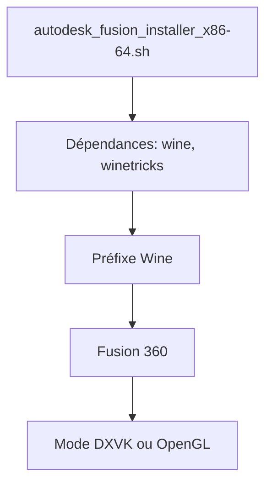

# cryinkfly/Autodesk-Fusion-360-for-Linux

> Script d'installation qui fait tourner Autodesk Fusion 360 sous Linux grâce à Wine.

## Le problème
Fusion 360 n'existe officiellement que pour Windows et macOS ; les utilisateurs Linux doivent maintenir à la main un préfixe Wine fragile.

## Ce que ça fait vraiment
Un script shell installe les dépendances (Wine, winetricks, p7zip, cabextract…), prépare un préfixe Wine et installe Fusion 360, avec une option `--full` pour les extensions testées. Il propose un mode DXVK ou OpenGL. L'application elle-même reste celle d'Autodesk.

## Comment c'est branché
Schéma simplifié d'après la fiche, sans diagramme fourni.


## Essayer
```bash
curl -L https://raw.githubusercontent.com/cryinkfly/Autodesk-Fusion-360-for-Linux/main/files/setup/autodesk_fusion_installer_x86-64.sh -o "autodesk_fusion_installer_x86-64.sh" && chmod +x autodesk_fusion_installer_x86-64.sh && ./autodesk_fusion_installer_x86-64.sh --install --default
```

## Coût et pièges
Le script est gratuit mais une licence Autodesk valide est obligatoire (essai 30 jours, usage personnel limité, abonnement payant). Le dépôt est archivé : le projet migre vers Codeberg. Les distributions listées ne sont pas supportées par Autodesk.

## Ce que ce n'est pas
Ce n'est pas une version native de Fusion 360 ni un remplaçant libre. L'assistant vocal n'est pas supporté ; le script ne fait « que » lancer le programme.

## Alternatives
Version Flatpak via Bottles (usebottles.com), citée dans le README.

## Pour toi
À ignorer : CAO propriétaire sous Wine, sans lien avec un profil data / IA / MLOps, et dépôt archivé.

