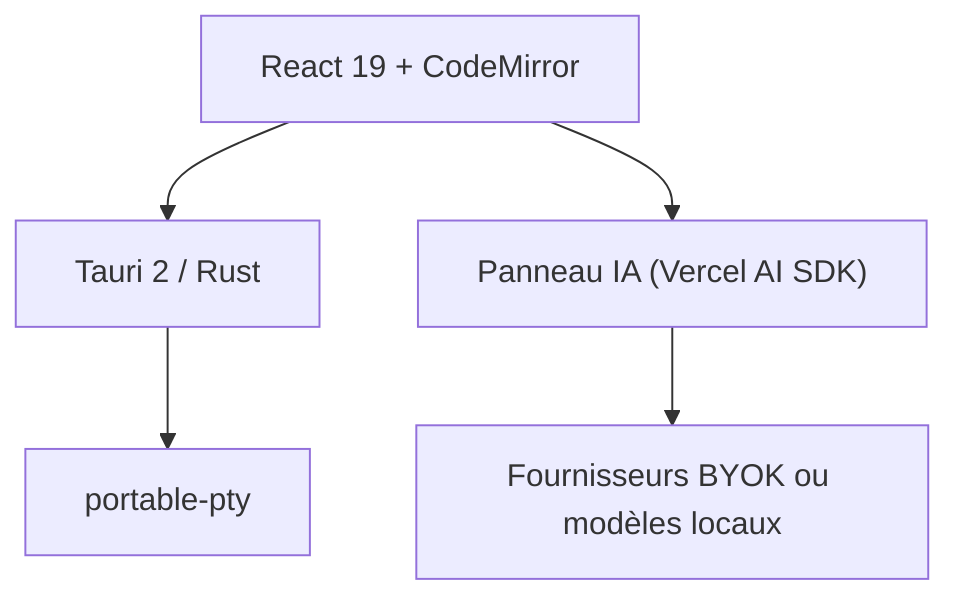

# crynta/terax-ai

> Lightweight terminal-centered development environment with an AI agent panel, built with Tauri and Rust.

## The problem
AI-assisted IDEs are heavy, tied to an account and often send data to a third party.

## What it actually does
A Tauri 2 application (Rust, React 19) of about 7-8 MB: terminal with native PTY, CodeMirror 6 editor, file explorer, source control with git graph, web preview. The AI panel works with your own keys (OpenAI, Anthropic, Gemini, etc.) or local models (Ollama, LM Studio, MLX), with agents, plan mode and Claude Code orchestration. No telemetry or account according to the README.

## How it is wired


## Trying it
```bash
pnpm install
pnpm tauri dev
pnpm tauri build
```

## Cost and gotchas
AI calls are billed by your provider. Keys are stored in the OS keychain. The maintainer announces a major rewrite (v0.9.0, libghostty + WebGPU) under way.

## What it is not
Not a stabilized editor: the architecture is going to change. The maintainer has also shifted their effort to another product.

## Alternatives
No alternative named in the README.

## For you
Keep an eye on it: interesting for a local workstation with local models, but a one-person project in the middle of a rewrite.
