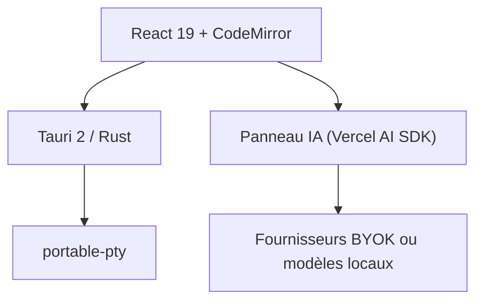

# crynta/terax-ai

> Environnement de développement léger centré terminal, avec panneau d'agents IA, en Tauri et Rust.

## Le problème
Les IDE assistés par IA sont lourds, liés à un compte et envoient souvent des données à un tiers.

## Ce que ça fait vraiment
Application Tauri 2 (Rust, React 19) d'environ 7-8 Mo : terminal avec PTY natif, éditeur CodeMirror 6, explorateur, contrôle de source avec graphe git, aperçu web. Le panneau IA fonctionne avec tes clés (OpenAI, Anthropic, Gemini, etc.) ou des modèles locaux (Ollama, LM Studio, MLX), avec agents, mode plan et orchestration de Claude Code. Sans télémétrie ni compte selon le README.

## Comment c'est branché


## Essayer
```bash
pnpm install
pnpm tauri dev
pnpm tauri build
```

## Coût et pièges
Les appels IA sont facturés par ton fournisseur. Les clés sont stockées dans le keychain de l'OS. Le mainteneur annonce une refonte majeure (v0.9.0, libghostty + WebGPU) en cours.

## Ce que ce n'est pas
Pas un éditeur stabilisé : l'architecture va changer. Le mainteneur a aussi déplacé son effort vers un autre produit.

## Alternatives
Aucune alternative nommée dans le README.

## Pour toi
Surveiller : intéressant pour un poste local avec modèles locaux, mais projet porté par une personne et en pleine refonte.

