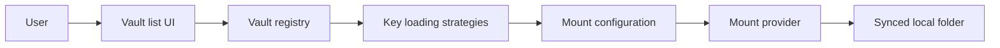

# cryptomator/cryptomator

> Client-side encryption of files synced to the cloud, through a virtual drive, for individuals and teams.

## The problem
Cloud providers can read your files; you need to encrypt before syncing without changing your habits.

## What it actually does
Creates encrypted vaults (AES 256, encrypted file names, obfuscated structure, Scrypt derivation) in a synced folder (Dropbox, Drive, OneDrive, Nextcloud…), mounted as a virtual drive. No account and no data sent. Handles recovery keys, health checks and updates.

## How it is wired


## Trying it
```bash
./mvnw clean install
./mvnw -Prun compile exec:exec
./mvnw -Prun,dev compile exec:exec
```

## Cost and gotchas
Free; binaries on cryptomator.org. Building requires JDK 26. Encrypts only the synced content.

## What it is not
Not a backup or a sync tool: it encrypts a folder that your cloud service synchronizes.

## Alternatives
No alternative named in the README.

## For you
Keep an eye on it: relevant for protecting sensitive datasets stored in a consumer cloud.
