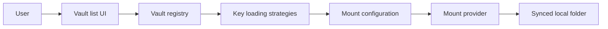

# cryptomator/cryptomator

> Chiffrement côté client de fichiers synchronisés dans le cloud, via un disque virtuel, pour particuliers et équipes.

## Le problème
Les fournisseurs cloud peuvent lire tes fichiers ; il faut chiffrer avant la synchronisation sans changer ses habitudes.

## Ce que ça fait vraiment
Crée des coffres chiffrés (AES 256, noms de fichiers chiffrés, structure obscurcie, dérivation Scrypt) dans un dossier synchronisé (Dropbox, Drive, OneDrive, Nextcloud…), montés comme lecteur virtuel. Sans compte ni donnée envoyée. Gère clés de récupération, contrôles de santé et mises à jour.

## Comment c'est branché


## Essayer
```bash
./mvnw clean install
./mvnw -Prun compile exec:exec
./mvnw -Prun,dev compile exec:exec
```

## Coût et pièges
Gratuit ; binaires sur cryptomator.org. Compilation : JDK 26. Chiffrement du seul contenu synchronisé.

## Ce que ce n'est pas
Pas une sauvegarde ni une synchronisation : il chiffre un dossier que ton service cloud synchronise.

## Alternatives
Aucune alternative nommée dans le README.

## Pour toi
À surveiller : pertinent pour protéger des jeux de données sensibles stockés dans un cloud grand public.

