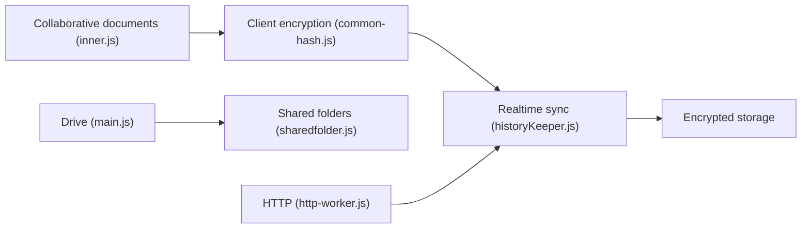

# cryptpad/cryptpad

> End-to-end encrypted open source collaboration suite, to self-host.

## The problem
Online collaboration tools see the content in clear text; a server leak exposes everything.

## What it actually does
The browser encrypts documents before sending them, synchronizes in real time, and the server stores encrypted data. Accounts derived from cryptographic keys, drive, shared folders, administration. The code (historyKeeper, http-worker) handles sync and storage. The README specifies that the encryption code is served by the instance: you must trust the administrator.

## How it is wired

## Trying it
The README points to the developer and administrator guides, and mentions a `Dockerfile` and `docker-compose.yml` at the root; no command appears there.

## Cost and gotchas
Free when self-hosted; production requires HTTPS and advanced configuration. AGPL-3.0. 373 open issues.

## What it is not
Not protected against a malicious server that alters the served code ("active attack"). Does not hide IP addresses.

## Alternatives
None named in the README.

## For you
Worth watching: relevant for a confidential self-hosted collaborative space; outside the data/AI core.
