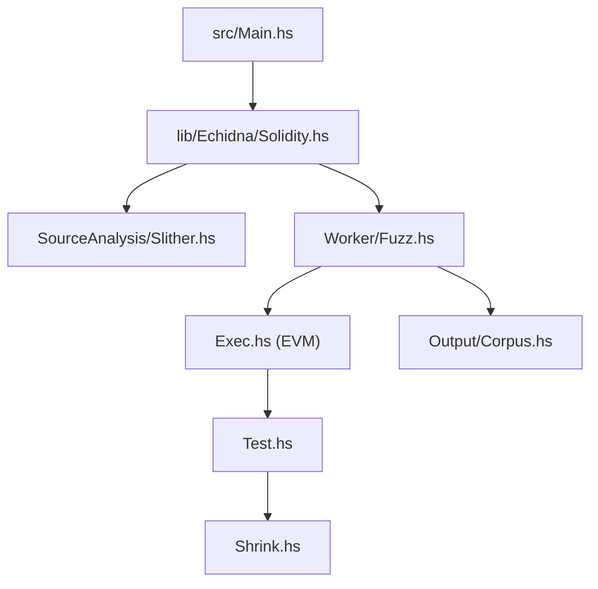

# crytic/echidna

> Ethereum smart contract fuzzer, written in Haskell, that falsifies Solidity invariants.

## The problem
A deployed smart contract is immutable: an invariant violated by a rare sequence of calls costs real funds.

## What it actually does
Generates call sequences from the contract ABI and checks properties (echidna_ functions, assertions, Foundry tests, integer overflows, optimization). It guides coverage with a corpus, minimizes counterexamples and relies on Slither to extract information before the campaign. Text, JSON and terminal interface outputs; an MCP server exists to drive a campaign.

## How it is wired


## Trying it
```bash
brew install echidna
echidna myContract.sol
echidna tests/solidity/basic/flags.sol
echidna contract.sol --contract TEST --config config.yaml
docker run --rm -it -v "$(pwd)":/src ghcr.io/crytic/echidna/echidna
```

## Cost and gotchas
Free, but Slither (pip) must be installed for the binaries. The Docker image only runs well on x86. Limited Vyper support, libraries poorly handled (wont fix status). AGPL license.

## What it is not
Not a formal proof: a fuzzer finds counterexamples, it does not guarantee the absence of bugs. Not an intrusion scanner for third-party systems.

## Alternatives
- Foundry (forge, included in the Docker image): Echidna's foundry mode to run the same tests.
- hevm: execution engine whose limits Echidna partly inherits.

## For you
Watch: the logic of coverage-guided fuzzing and counterexample minimization inspires property testing, but the tool is only useful if you audit Solidity.
