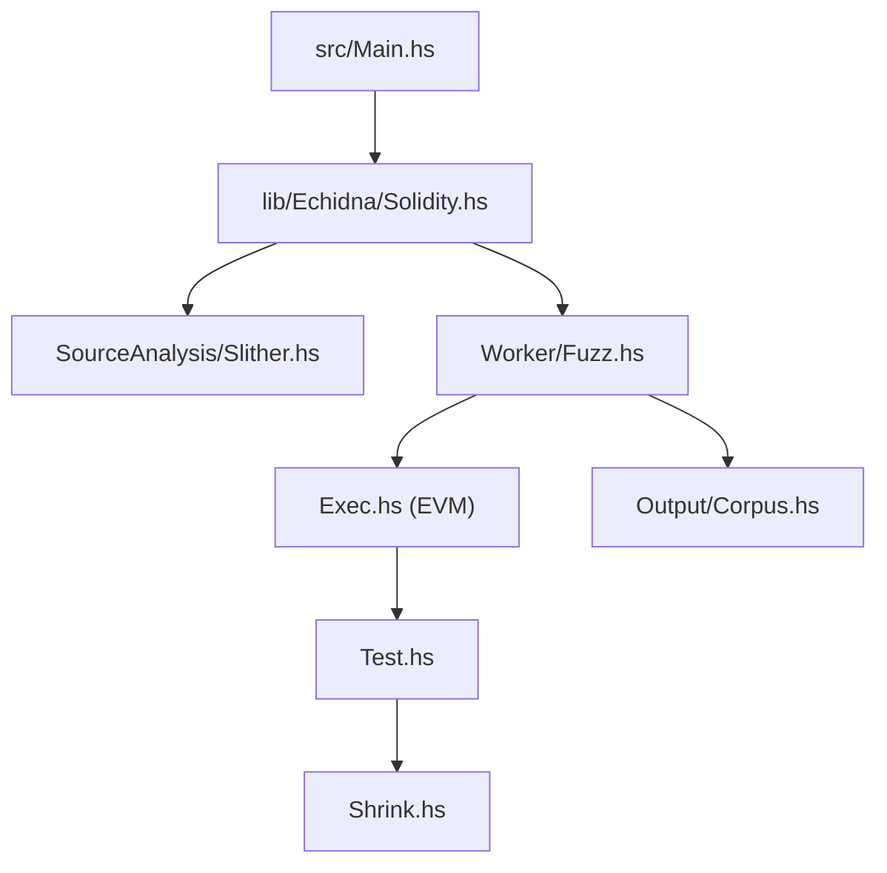

# crytic/echidna

> Fuzzer de contrats intelligents Ethereum, écrit en Haskell, qui falsifie des invariants Solidity.

## Le problème
Un contrat intelligent déployé est immuable : un invariant violé par une séquence d'appels rare coûte des fonds réels.

## Ce que ça fait vraiment
Génère des séquences d'appels à partir de l'ABI du contrat et vérifie des propriétés (fonctions echidna_, assertions, tests Foundry, dépassements d'entiers, optimisation). Il guide la couverture par corpus, minimise les contre-exemples et s'appuie sur Slither pour extraire des informations avant la campagne. Sorties texte, JSON, interface terminal ; un serveur MCP existe pour piloter une campagne.

## Comment c'est branché


## Essayer
```bash
brew install echidna
echidna myContract.sol
echidna tests/solidity/basic/flags.sol
echidna contract.sol --contract TEST --config config.yaml
docker run --rm -it -v "$(pwd)":/src ghcr.io/crytic/echidna/echidna
```

## Coût et pièges
Gratuit, mais Slither (pip) doit être installé pour les binaires. L'image Docker ne tourne bien que sur x86. Support Vyper limité, bibliothèques mal gérées (statut wont fix). Licence AGPL.

## Ce que ce n'est pas
Pas une preuve formelle : un fuzzer trouve des contre-exemples, il ne garantit pas l'absence de bug. Pas un scanner d'intrusion sur des systèmes tiers.

## Alternatives
- Foundry (forge, inclus dans l'image Docker) : mode foundry d'Echidna pour exécuter les mêmes tests.
- hevm : moteur d'exécution dont Echidna hérite certaines limites.

## Pour toi
Surveiller : la logique de fuzzing guidé par couverture et de minimisation de contre-exemples inspire le test de propriétés, mais l'outil ne sert que si tu audites du Solidity.

