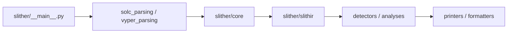

# crytic/slither

> Python static analyzer for Solidity and Vyper contracts, for smart contract developers and auditors.

## The problem
Smart contract flaws (reentrancy, delegatecall) are costly once deployed.

## What it actually does
Compiles the contract via solc or a framework (Hardhat, Foundry), builds a model and an intermediate representation, SlithIR, then runs about a hundred detectors ranked by impact and confidence. Provides "printers" (call graph, inheritance, CFG), tools (check-upgradeability, flat, read-storage) and an API for writing your own detectors. Markdown/SARIF output for CI.

## How it is wired


## Trying it
```bash
uv tool install slither-analyzer
python3 -m pip install slither-analyzer
slither .
slither tests/uninitialized.sol
```

## Cost and gotchas
Free. Python 3.10+, and solc; projects with dependencies must compile (`slither .`). AGPL-3.0 license (strong copyleft).

## What it is not
Not a proof of security: static analysis produces false positives and false negatives; it does not replace an audit.

## Alternatives
None named in the README.

## For you
Worth watching: only if your work touches Solidity contracts; otherwise, off-topic.
