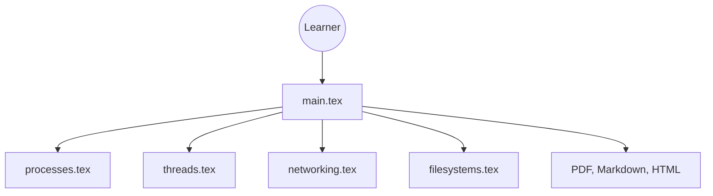

# cs341-illinois/coursebook

> Free systems programming textbook in C, used in the CS 341 course at the University of Illinois.

## The problem
Systems programming textbooks are expensive, or are wikis lacking rigor and citations.

## What it actually does
A book written in LaTeX, which assumes some assembly basics and uses C. The chapters cover processes, threads, scheduling, synchronization, deadlock, signals, IPC, networking, file systems, memory allocation and security. The README announces PDF, Markdown and HTML exports, with citations and a glossary.

## How it is wired


## Trying it
```bash
# Aucune commande documentée : le PDF le plus récent est lié depuis le README (main.pdf).
```

## Cost and gotchas
Free, but no license in the catalog: usage and redistribution are not framed. The LaTeX build chain is not described.

## What it is not
Not a course on ML or MLOps. The README does not say how to rebuild the exports.

## Alternatives
- Angrave's Wikibook: the original experience that this book takes up and hardens.

## For you
Worth watching as a reference reading: the threads, memory and networking chapters help understand the performance of a service, but there is nothing to install or integrate.
