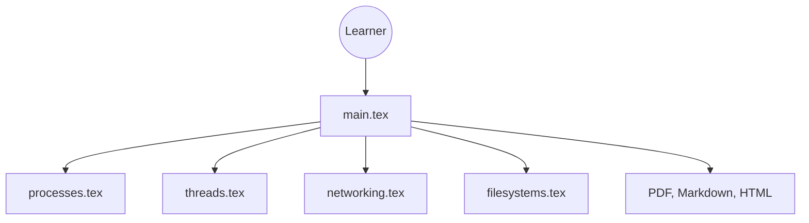

# cs341-illinois/coursebook

> Manuel libre de programmation système en C, utilisé au cours CS 341 de l'Université d'Illinois.

## Le problème
Les manuels de programmation système sont chers, ou des wikis sans rigueur ni citations.

## Ce que ça fait vraiment
Un livre écrit en LaTeX, qui suppose des bases d'assembleur et utilise C. Les chapitres couvrent processus, threads, ordonnancement, synchronisation, interblocage, signaux, IPC, réseau, systèmes de fichiers, allocation mémoire et sécurité. Le README annonce des exports PDF, Markdown et HTML, avec citations et glossaire.

## Comment c'est branché


## Essayer
```bash
# Aucune commande documentée : le PDF le plus récent est lié depuis le README (main.pdf).
```

## Coût et pièges
Gratuit, mais aucune licence dans le catalogue : l'usage et la redistribution ne sont pas cadrés. La chaîne de build LaTeX n'est pas décrite.

## Ce que ce n'est pas
Pas un cours sur le ML ou le MLOps. Le README ne dit pas comment reconstruire les exports.

## Alternatives
- Wikibook d'Angrave : l'expérience d'origine que ce livre reprend et durcit.

## Pour toi
À surveiller comme lecture de référence : les chapitres threads, mémoire et réseau aident à comprendre les performances d'un service, mais rien à installer ou intégrer.

