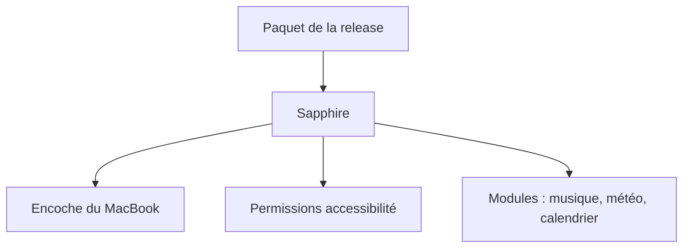

# cshariq/Sapphire

> App for recent MacBook notches: activities around the notch, sharing, windows and tools.

## The problem
The notch on recent MacBooks serves no purpose on screen; its surroundings go unused.

## What it actually does
The very short README says the app displays ongoing activities around the notch. It offers proximity sharing to transfer files and a window-tiling system. It also lists modules (now playing, weather, Gemini, calendar, lock screen, file shelf, Bluetooth, caffeine), without detail.

## How it is wired
Simplified diagram based on the fiche, no diagram provided.


## Trying it
```text
1. Télécharger le dernier paquet depuis la page des releases.
2. Ouvrir le paquet et suivre l'installation.
3. Au premier lancement, accorder l'accessibilité dans Réglages Système.
```

## Cost and gotchas
Free according to the README; system permissions are requested. The Gemini module suggests a third-party service, undocumented.

## What it is not
Not a tool for developers nor a data project. Documentation is minimal: features are only named.

## Alternatives
No alternative named in the README.

## For you
Ignore: a macOS comfort utility unrelated to data or MLOps, and its documentation is too thin to judge.
