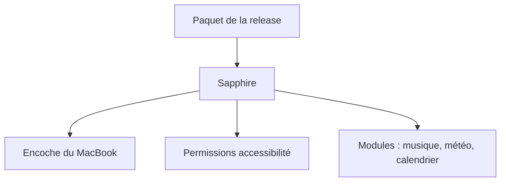

# cshariq/Sapphire

> Application pour l'encoche des MacBook récents : activités autour de l'encoche, partage, fenêtres et outils.

## Le problème
L'encoche des MacBook récents ne sert à rien à l'écran ; ses abords restent inexploités.

## Ce que ça fait vraiment
Le README, très court, dit que l'app affiche les activités en cours autour de l'encoche. Elle propose le partage de proximité pour transférer des fichiers et un système de rangement de fenêtres. Il liste aussi des modules (lecture en cours, météo, Gemini, calendrier, écran verrouillé, étagère de fichiers, Bluetooth, caféine), sans détail.

## Comment c'est branché
Schéma simplifié d'après la fiche, sans diagramme fourni.


## Essayer
```text
1. Télécharger le dernier paquet depuis la page des releases.
2. Ouvrir le paquet et suivre l'installation.
3. Au premier lancement, accorder l'accessibilité dans Réglages Système.
```

## Coût et pièges
Gratuit d'après le README ; des permissions système sont demandées. Le module Gemini laisse penser à un service tiers, non documenté.

## Ce que ce n'est pas
Ce n'est pas un outil pour développeurs ni un projet de données. La documentation est minimale : les fonctions ne sont que nommées.

## Alternatives
Aucune alternative nommée dans le README.

## Pour toi
À ignorer : c'est un utilitaire de confort macOS sans rapport avec la data ou le MLOps, et sa documentation est trop mince pour juger.

