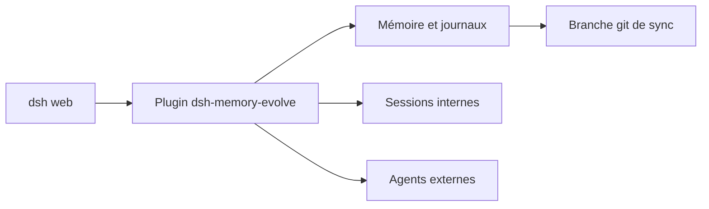

# csyangwen/dsh-memory-evolve

> Plugin for DSH that gives AI sessions long-term memory, tasks, skills and orchestration.

## The problem
Conversations with an AI are disposable: switching session or project loses the context.

## What it actually does
Five-track memory (profile, global facts, project memory, logs), validated by the user before writing. Adds tasks, local file search, a team of internal sessions, delegation to external agents (Kimi, Codex, Grok, Hermes), a prompt library, bookmarks, a session evaluator and a canvas. Memory synchronization via git.

## How it is wired
Simplified diagram based on the sheet, no diagram provided.


## Trying it
```bash
dsh plugin --profile web add github:csyangwen/dsh-memory-evolve
dsh plugin --profile web remove dsh-memory-evolve
```

## Cost and gotchas
Requires DSH, a little-used tool. External agents need their own access. Documentation in Chinese; many modules are disabled by default.

## What it is not
It is not a standalone tool: it only works inside DSH. It does not write to memory without your confirmation.

## Alternatives
No alternative named in the README.

## For you
Worth watching: interesting ideas on agent memory, but tied to an obscure host and maintained by a single person.
