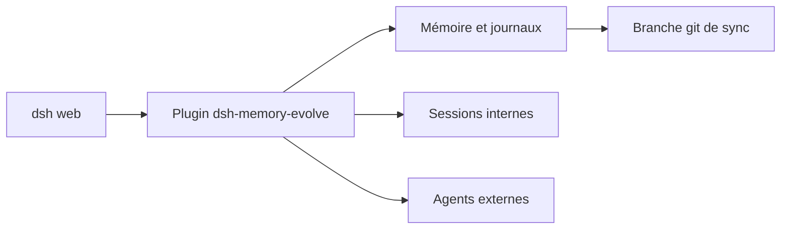

# csyangwen/dsh-memory-evolve

> Plugin pour DSH qui donne aux sessions IA une mémoire longue, des tâches, des compétences et de l'orchestration.

## Le problème
Les conversations avec une IA sont jetables : changer de session ou de projet fait perdre le contexte.

## Ce que ça fait vraiment
Mémoire à cinq pistes (profil, faits globaux, mémoire de projet, journaux), validée par l'utilisateur avant écriture. Ajoute tâches, recherche de fichiers locaux, équipe de sessions internes, délégation à des agents externes (Kimi, Codex, Grok, Hermes), bibliothèque de prompts, signets, évaluateur de session et canevas. Synchronisation de la mémoire via git.

## Comment c'est branché
Schéma simplifié d'après la fiche, sans diagramme fourni.


## Essayer
```bash
dsh plugin --profile web add github:csyangwen/dsh-memory-evolve
dsh plugin --profile web remove dsh-memory-evolve
```

## Coût et pièges
Nécessite DSH, un outil peu répandu. Les agents externes demandent leurs propres accès. Documentation en chinois ; beaucoup de modules sont désactivés par défaut.

## Ce que ce n'est pas
Ce n'est pas un outil autonome : il ne fonctionne que dans DSH. Il n'écrit pas dans la mémoire sans ta confirmation.

## Alternatives
Aucune alternative nommée dans le README.

## Pour toi
À surveiller : idées intéressantes sur la mémoire d'agent, mais lié à un hôte confidentiel et maintenu par une seule personne.

