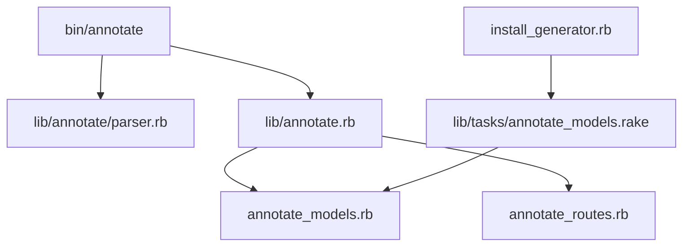

# ctran/annotate_models

> Ruby gem that adds the database schema as a comment in Rails models, for Rails developers.

## The problem
In a Rails project, a table's columns are not visible in the model file.

## What it actually does
The `annotate` command writes, at the top or bottom of a file, a comment with the schema: ActiveRecord models, fixtures, tests, factories, and `routes.rb`. Rake tasks and a generator rerun it on every `db:migrate` in development. Many options for sorting, position and format (rdoc, yard, markdown).

## How it is wired
Diagram based on the one provided.



## Trying it
```bash
gem install annotate
cd /path/to/app
annotate --models
annotate --routes
annotate --delete
```

## Cost and gotchas
Free. It rewrites the existing comment block: add nothing after it, and check with `git status`. Last push in August 2024, 145 open issues.

## What it is not
Not a database documentation or migration tool. Since version 3 you must pass `--models` explicitly.

## Alternatives
No alternative named in the README.

## For you
Ignore: Rails-only, outside your field, and little maintained for over a year.
