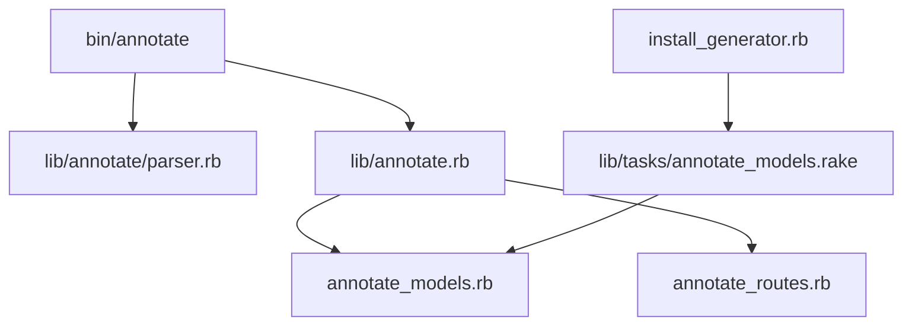

# ctran/annotate_models

> Gem Ruby qui ajoute en commentaire le schéma de base dans les modèles Rails, pour développeurs Rails.

## Le problème
Dans un projet Rails, les colonnes d'une table ne sont pas visibles dans le fichier du modèle.

## Ce que ça fait vraiment
La commande `annotate` écrit en tête ou en pied de fichier un commentaire avec le schéma : modèles ActiveRecord, fixtures, tests, factories, et `routes.rb`. Les tâches rake et un générateur la relancent à chaque `db:migrate` en développement. Nombreuses options de tri, de position et de format (rdoc, yard, markdown).

## Comment c'est branché
Schéma d'après le diagramme fourni.



## Essayer
```bash
gem install annotate
cd /path/to/app
annotate --models
annotate --routes
annotate --delete
```

## Coût et pièges
Gratuit. Il réécrit le bloc de commentaires existant : ne rien ajouter après, et vérifier avec `git status`. Dernier push en août 2024, 145 issues ouvertes.

## Ce que ce n'est pas
Pas un outil de documentation de base ni de migration. Depuis la version 3 il faut passer `--models` explicitement.

## Alternatives
Aucune alternative nommée dans le README.

## Pour toi
À ignorer : réservé à Rails, hors de ton domaine, et peu suivi depuis plus d'un an.

