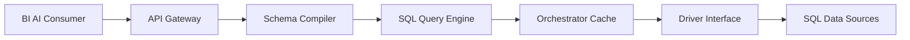

# cube-js/cube

> Couche sémantique open source qui définit métriques et accès une fois, exposés en SQL, REST et GraphQL.

## Le problème
Chaque outil BI ou agent IA redéfinit ses métriques : résultats divergents et logique dupliquée.

## Ce que ça fait vraiment
Modèle de données en code (mesures, dimensions, jointures, règles d'accès) compilé en SQL pour tes sources (Snowflake, BigQuery, Databricks, Postgres…). Passerelle d'API REST/GraphQL/SQL/abonnements, cache relationnel intégré (Cube Store) pour la latence. Pas d'interface : « headless ». L'offre commerciale Cube ajoute chat, tableaux de bord et RBAC.

## Comment c'est branché


## Essayer
```bash
docker run -p 4000:4000 \
  -p 15432:15432 \
  -v ${PWD}:/cube/conf \
  -e CUBEJS_DEV_MODE=true \
  cubejs/cube
```

## Coût et pièges
Mode dev = contournement d'authentification : ne jamais l'exposer ni l'utiliser en production (README). Sans mot de passe SQL, l'API SQL accepte tout identifiant. Licence présente mais non identifiée par GitHub.

## Ce que ce n'est pas
Pas une base ni une appli BI : il n'a pas d'interface. Les fonctions de gestion sont dans l'offre payante.

## Alternatives
Cube (offre commerciale, même couche sémantique), cité dans le README.

## Pour toi
Adopter : une couche sémantique gouvernée est précieuse pour alimenter BI et agents avec les mêmes métriques ; vérifie la licence et ne lance jamais le mode dev en production.

