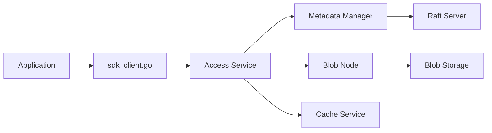

# cubefs/cubefs

> Distributed file and object storage system, CNCF graduated project, for datacenters and data lakes.

## The problem
Separating compute and storage for databases, search or AI requires scalable, multi-protocol, multi-tenant shared storage.

## What it actually does
POSIX, HDFS, S3 and REST API access.
Distributed metadata with strong consistency (Raft); replication or erasure coding, your choice.
Optimizations for small/large files and sequential/random writes; multi-level cache on top of S3.
Schedulers for repair, migration and rebalancing.

## How it is wired

## Trying it
No command in the README: it points to the online documentation.

## Cost and gotchas
Free; a multi-node cluster to operate. The master branch may be broken: use the releases.

## What it is not
Not storage you set up in five minutes on a laptop. Landing README without a getting-started guide.

## Alternatives
No alternative named in the README.

## For you
Worth watching if you have to build an on-premise data lake for training: a serious CNCF option, but operating it is an infra team's job.
