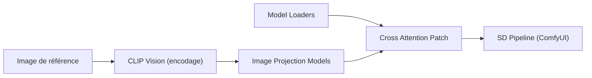

# cubiq/ComfyUI_IPAdapter_plus

> A ComfyUI extension that applies reference images (subject, style, face) to image generation.

## The problem
Transferring the style or subject of an image without training a LoRA.

## What it actually does
ComfyUI nodes implementing IPAdapter ("one-image LoRA") for SD1.5 and SDXL: basic, plus, face and FaceID models (with insightface and LoRA), a unified loader with mandatory file names, cross-attention patching, weighting and regional conditioning. It requires CLIP Vision encoders and models to be downloaded separately.

## How it is wired

## Trying it
No documented command: clone the repository into `ComfyUI/custom_nodes/` or use the Manager, then place the models in `models/clip_vision`, `models/ipadapter` and `models/loras`.

## Cost and gotchas
A GPU is needed to generate. File names must be respected exactly for the unified loader. Since April 2025: "maintenance only" mode announced by the author.

## What it is not
Not a standalone tool: it requires an up-to-date ComfyUI. GPL-3.0 license.

## Alternatives
None named in the README.

## For you
Worth watching if you do generative imagery under ComfyUI; otherwise leave it, an end-of-life project.
