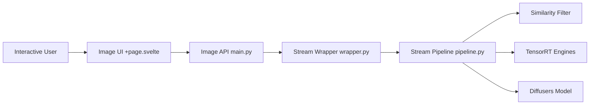

# cumulo-autumn/StreamDiffusion

> Real-time diffusion pipeline for interactive image generation (txt2img, img2img, webcam).

## The problem
Standard Stable Diffusion pipelines are too slow for interactive use (webcam feeds, live generation).

## What it actually does
Wraps a Diffusers `StableDiffusionPipeline`: Stream Batch, Residual CFG, stochastic similarity filter, I/O queues.
LCM-LoRA fusion, tiny VAE, xformers or TensorRT acceleration (engine building).
Claimed measurements: ~106 fps txt2img with SD-turbo on an RTX 4090.
Real-time web demos for txt2img and img2img (webcam, screen capture).

## How it is wired


## Trying it
```bash
git clone https://github.com/cumulo-autumn/StreamDiffusion.git
conda create -n streamdiffusion python=3.10
conda activate streamdiffusion
pip3 install torch==2.1.0 torchvision==0.16.0 xformers --index-url https://download.pytorch.org/whl/cu121
pip install streamdiffusion[tensorrt]
python -m streamdiffusion.tools.install-tensorrt
```

## Cost and gotchas
An NVIDIA GPU is required, versions are pinned (torch 2.1.0). Last push in December 2024: ageing dependencies.

## What it is not
Not a model: an acceleration pipeline around existing SD models. Not actively maintained.

## Alternatives
None named in the README.

## For you
Ignore: interesting techniques (RCFG, similarity filter) to read in the paper, but the code is frozen since late 2024 on a dated PyTorch stack.
