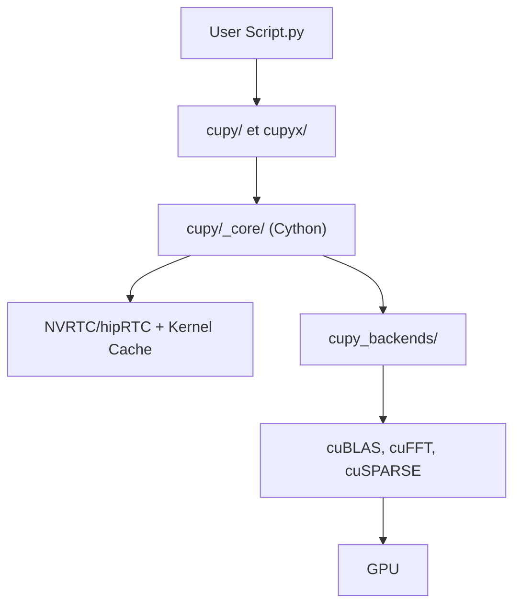

# cupy/cupy

> NumPy/SciPy-compatible array library that runs on NVIDIA or AMD GPUs.

## The problem
Numerical NumPy/SciPy code runs on CPU and becomes slow on large arrays.

## What it actually does
Reuses the NumPy and SciPy API on CUDA or ROCm. Also gives low-level access: RawKernels, streams, CUDA runtime calls. According to the code, a backend layer (CUDA, ROCm, stub) relies on cuBLAS, cuFFT, etc., with NVRTC just-in-time compilation and a kernel cache.

## How it is wired


## Trying it
```bash
pip install cupy-cuda12x
conda install -c conda-forge cupy
docker run --gpus all -it cupy/cupy
```

## Cost and gotchas
An NVIDIA GPU (CUDA 12.x/13.x) or AMD GPU (ROCm 7.0, marked experimental) is required. Pick the right pip package for your CUDA version.

## What it is not
Not an automatic replacement without a GPU, and not a deep learning framework. 691 open issues.

## Alternatives
No alternative named in the README.

## For you
Adopt it if you have a GPU and NumPy code to speed up: minimal change, according to the README.
