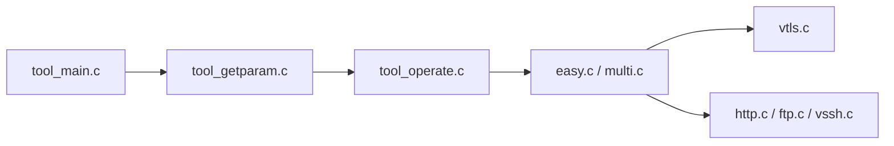

# curl/curl

> Command-line tool and libcurl library for transferring data by URL, across all common protocols.

## The problem
You need to test or script HTTP, FTP, SFTP, SMTP… exchanges with a single portable tool.

## What it actually does
The CLI parses the options, creates an "easy handle", schedules the transfer in the multi engine, resolves DNS, negotiates TLS and authentication, then streams the data to a file or to callbacks. Protocol list: DICT, FILE, FTP(S), HTTP(S), IMAP, LDAP, MQTT, POP3, SCP, SFTP, SMTP, TELNET, TFTP, WS/WSS, etc. libcurl is the same base usable as a library.

## How it is wired


## Trying it
```bash
git clone https://github.com/curl/curl
```
For usage, the README points to the man page and to "everything curl".

## Cost and gotchas
Free. Specific "MIT-like" license (SPDX: curl), not recognized by GitHub: check it.

## What it is not
Not an API client with a graphical interface, nor a browser.

## Alternatives
No alternative named in the README.

## For you
Adopt: already present everywhere, essential for testing model or service APIs; the license is permissive, to be confirmed for redistribution.
