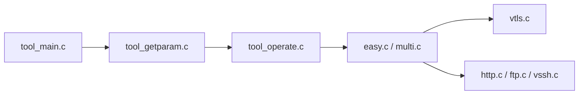

# curl/curl

> Outil en ligne de commande et bibliothèque libcurl pour transférer des données par URL, tous protocoles courants.

## Le problème
Il faut tester ou scripter des échanges HTTP, FTP, SFTP, SMTP… avec un outil unique et portable.

## Ce que ça fait vraiment
La CLI analyse les options, crée un « easy handle », planifie le transfert dans le moteur multi, résout le DNS, négocie TLS et l'authentification, puis diffuse les données vers un fichier ou des callbacks. Liste de protocoles : DICT, FILE, FTP(S), HTTP(S), IMAP, LDAP, MQTT, POP3, SCP, SFTP, SMTP, TELNET, TFTP, WS/WSS, etc. libcurl est la même base utilisable en bibliothèque.

## Comment c'est branché


## Essayer
```bash
git clone https://github.com/curl/curl
```
Pour l'usage, le README renvoie à la page man et à « everything curl ».

## Coût et pièges
Gratuit. Licence « MIT-like » spécifique (SPDX : curl), non reconnue par GitHub : à vérifier.

## Ce que ce n'est pas
Pas un client d'API avec interface graphique ni un navigateur.

## Alternatives
Aucune alternative nommée dans le README.

## Pour toi
Adopter : déjà présent partout, indispensable pour tester des API de modèles ou de services ; la licence est permissive, à confirmer pour redistribution.

