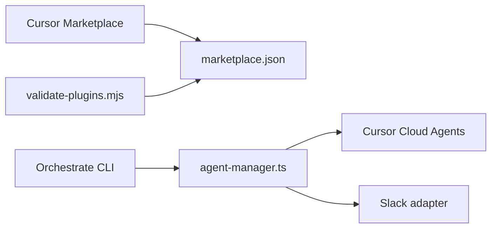

# cursor/plugins

> Catalog of official Cursor plugins: skills, rules and MCP servers for dozens of SaaS.

## The problem
Connecting a coding agent to Gmail, GitHub, BigQuery, Salesforce… requires repeated MCP wiring.

## What it actually does
Each plugin is a folder with its manifest `.cursor-plugin/plugin.json` (skills, rules, mcp.json). A validator (`scripts/validate-plugins.mjs`) checks the catalog. The most substantial is `orchestrate`: a Bun CLI that creates Cursor cloud agents as planner/worker/verifier, with Slack as an option. Others: continual-learning (AGENTS.md updates), pstack, pr-review-canvas.

## How it is wired


## Trying it
```bash
# Aucune commande documentée : installation via le Marketplace Cursor
```

## Cost and gotchas
Assumes Cursor; integration plugins require accounts on the targeted SaaS. No license declared in the catalog.

## What it is not
Not a standalone library: only works with Cursor. Many listed plugins do not have their code in the repository.

## Alternatives
No alternative named in the README.

## For you
Watch: `orchestrate` and `continual-learning` offer agentic patterns to study, but everything depends on Cursor and a missing license.
